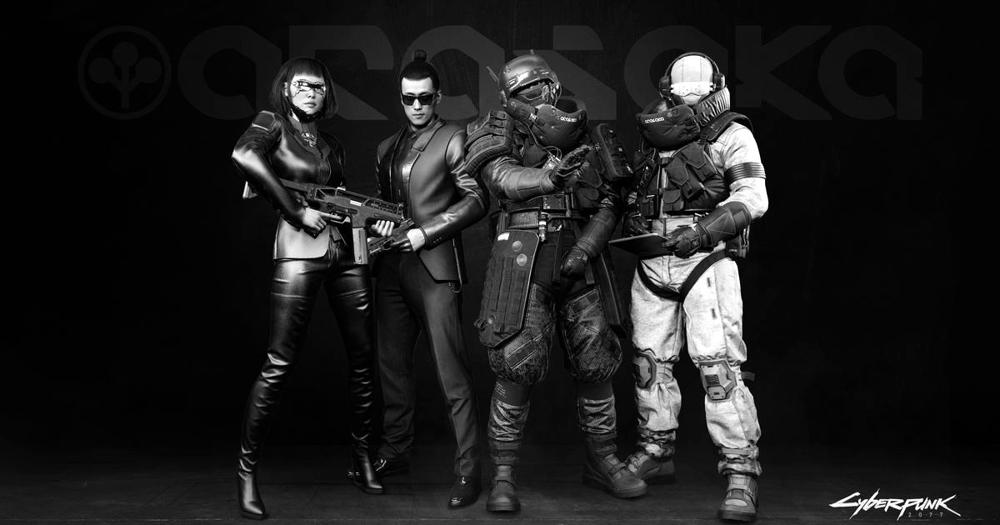
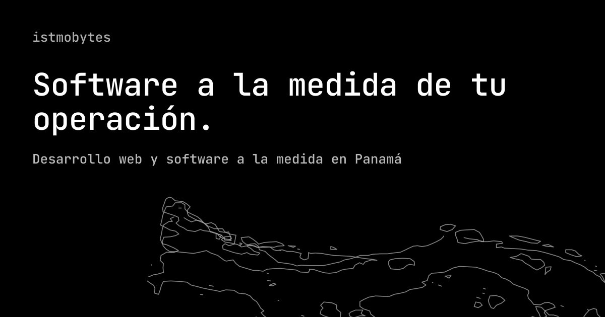
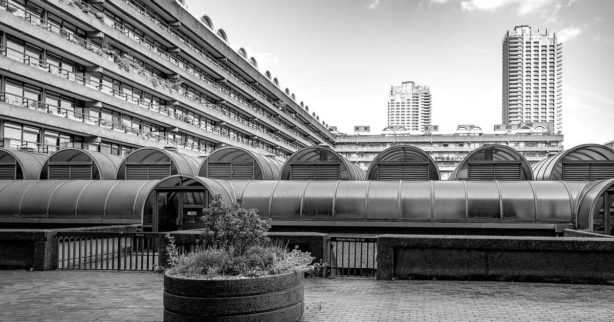
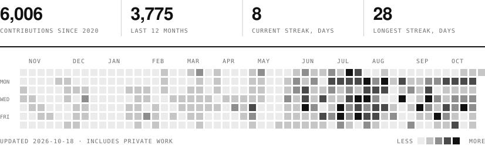

# Miguel

**Full-stack developer. Panamá.**<br />
I design and build web applications, internal systems and data platforms, from the database to the last pixel.

<sub>Desarrollador full-stack en Panamá. Diseño y construyo aplicaciones web, sistemas internos y plataformas de datos.</sub>

<br />

## 01 — Index

| №  | Project               | Kind               | Stack                                | Link                                                        |
| :- | :-------------------- | :----------------- | :----------------------------------- | :---------------------------------------------------------- |
| 01 | Arasaka               | Fan site           | Next.js · TypeScript · i18n          | [Visit ↗](https://arasaka-blush.vercel.app)                 |
| 02 | istmobytes            | Studio site        | Next.js · TypeScript · i18n          | [Visit ↗](https://istmo.vercel.app)                         |
| 03 | Photography portfolio | Portfolio, shop    | Next.js · TypeScript                 | [Visit ↗](https://photography-website-phi-tawny.vercel.app) |
| 04 | RIS/PACS client       | Medical imaging    | Next.js 16 · React 19 · shadcn/ui    | Private                                                     |
| 05 | Insurance claims      | API + web client   | ASP.NET Core · EF Core · TypeScript  | Private                                                     |

<sub>Source code is private; the sites are live. · El código es privado; los sitios están en línea.</sub>

<table>
  <tr>
    <td width="33%" valign="top">
      <a href="https://arasaka-blush.vercel.app"></a>
      <br /><sub><b>01</b>&nbsp;&nbsp;Arasaka</sub>
    </td>
    <td width="33%" valign="top">
      <a href="https://istmo.vercel.app"></a>
      <br /><sub><b>02</b>&nbsp;&nbsp;istmobytes</sub>
    </td>
    <td width="33%" valign="top">
      <a href="https://photography-website-phi-tawny.vercel.app"></a>
      <br /><sub><b>03</b>&nbsp;&nbsp;Photography portfolio</sub>
    </td>
  </tr>
</table>

<br />

## 02 — Practice

<table>
  <tr>
    <td width="33%" valign="top">
      <b>Web</b><br /><br />
      Corporate sites, portfolios and client portals. Fast, multilingual, built to be maintained.
      <br /><br /><sub>Sitios, portafolios y portales.</sub>
    </td>
    <td width="33%" valign="top">
      <b>Systems</b><br /><br />
      Internal tools and REST APIs that replace spreadsheets and manual steps in day-to-day operations.
      <br /><br /><sub>Sistemas internos y APIs.</sub>
    </td>
    <td width="33%" valign="top">
      <b>Data</b><br /><br />
      Cleaning, consolidating and modelling scattered data into reports and dashboards people can trust.
      <br /><br /><sub>Datos, reportes y dashboards.</sub>
    </td>
  </tr>
</table>

<br />

## 03 — Tools

```
Front    TypeScript   Next.js   React   Astro   Vue   Tailwind CSS
Back     C#   ASP.NET Core   Entity Framework Core   Python   Django
Ship     Git   Vercel
```

<br />

## 04 — Activity

<picture>
  <source media="(prefers-color-scheme: dark)" srcset="assets/contributions-dark.svg" />
  
</picture>

<sub>Redrawn every day by a GitHub Action. · Se actualiza a diario.</sub>

<br />

## 05 — Contact

[miguelalveo@gmail.com](mailto:miguelalveo@gmail.com)&nbsp;&nbsp;·&nbsp;&nbsp;[github.com/Spidey507](https://github.com/Spidey507)

<br />


<sub>Panamá · UTC−5 · Photographs generated for this page.</sub>
